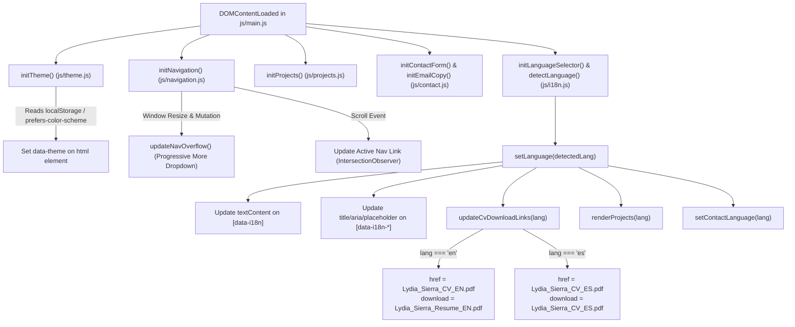

# Lydia Sierra Developer Portfolio — Complete Project Overview & Technical Brief

**Document Version:** 1.0.0  
**Target Audience:** AI Assistants (Gemini / Claude / GPT), Technical Reviewers, Frontend Engineers  
**Project Owner:** Lydia Sierra (Junior Software Developer · Pereira, Risaralda, Colombia)  
**Repository Working Directory:** `c:\Users\Lydia\Documents\GitHub\portfolio`  
**Current Active Branch:** `fix/projects-rehaul`  

---

## 1. Executive Summary & Project Purpose

This repository houses the personal, production-grade developer portfolio for **Lydia Sierra**, engineered to present her credentials as a Junior Software Developer to recruiters, engineering managers, and technical collaborators.

### Key Goals
1. **Showcase Authentic Experience**: Highlight real-world enterprise experience gained during her apprenticeship at **Globant**, freelance client deliverables, and institutional software development education at **SENA (ADSO)**.
2. **Demonstrate Modern Web Craft**: Showcase clean, semantic web architecture built with pure web standards without relying on heavyweight frameworks or build pipelines.
3. **Facilitate Recruiter Engagement**: Provide instant, localized CV/resume downloads in both English and Spanish (synchronized to the user's active language) and accessible direct contact channels.
4. **Art Direction & Tone**: Deliver a warm, editorial, human-centered design with a refined developer aesthetic (cream backgrounds, dark earth text, sage olive green, subtle turquoise, and blush accents) with WCAG 2.1 AA accessibility.

### Strict Content Integrity Policy
- Every project, metric, role, and credential in this repository is **100% authentic**.
- No synthetic experience, fabricated client names, placeholder lorem ipsum, or fake star ratings.

---

## 2. Core Architecture & Strict Technology Constraints

As mandated by the project governance guidelines (`AGENTS.md`):

| Constraint | Specification & Rules |
| :--- | :--- |
| **Technology Stack** | **Semantic HTML5**, modern **Vanilla CSS3** (Custom Properties, Flexbox, Grid), and **Vanilla JavaScript (ES Modules)**. |
| **Zero Frameworks** | Strictly **no** React, Angular, Vue, Svelte, Tailwind CSS, Bootstrap, or any component library in production. |
| **Zero Build Tools** | Strictly **no** Node.js build pipelines, Vite, Webpack, Parcel, Rollup, PostCSS, Sass/SCSS, TypeScript, or Babel. Files run natively in modern web browsers. |
| **Static Deployment** | Designed for 100% static hosting on **GitHub Pages**. All asset references, scripts, and stylesheets utilize relative paths (`assets/...`, `css/...`, `js/...`). |
| **Accessibility Standard** | **WCAG 2.1 AA Compliance**. Visible `:focus-visible` styling, logical tab order, keyboard navigation for all interactive components, focus traps on modal/drawer, semantic landmark elements, and polite screen reader announcements (`aria-live`). |
| **Git Governance Protocol** | `main` = stable deployable release; `develop` = integration. All work is isolated in dedicated feature branches (`fix/*`, `feat/*`). **Never auto-commit, merge, or push without explicit user review and approval.** |

---

## 3. Design System & Visual Tokens

The design system is codified as pure CSS Custom Properties in [`css/variables.css`](css/variables.css) with seamless Light and Dark mode support.

### 3.1 Color Palette

```
LIGHT THEME ([data-theme="light"]):
  --color-bg:               #F8F5F2  (Warm Editorial Cream)
  --color-surface:          #FFFFFF  (Pure White Surface)
  --color-surface-subtle:   #FBF9F7  (Soft Cream Tint)
  --color-text-main:        #2E2A27  (Dark Earth Brown - Contrast Ratio 12:1)
  --color-text-muted:       #6E6862  (Muted Taupe - Contrast Ratio 5.2:1)
  --color-primary:          #4A5D4E  (Refined Olive Green)
  --color-primary-hover:    #3C4B3F
  --color-accent-turquoise: #7BCBC4  (Vibrant Turquoise Accent)
  --color-accent-pink:      #F2D5D5  (Soft Blush Pink Accent)
  --color-border:           #E5DFD9
  --color-border-subtle:    #EFEAE4

DARK THEME ([data-theme="dark"]):
  --color-bg:               #181614  (Deep Charcoal Obsidian)
  --color-surface:          #24201D  (Warm Dark Slate)
  --color-surface-subtle:   #2D2825  (Elevated Dark Surface)
  --color-text-main:        #F5F2EE  (Soft Linen Off-White - Contrast Ratio 14:1)
  --color-text-muted:       #A8A199  (Light Taupe Grey)
  --color-primary:          #6E8E74  (Luminous Sage Olive Green)
  --color-primary-hover:    #82A388
  --color-accent-turquoise: #7BCBC4
  --color-accent-pink:      #F2D5D5
  --color-border:           #3D3733
  --color-border-subtle:    #302A26
```

### 3.2 Typography Tokens

- **Display & Section Titles**: `Instrument Serif`, Georgia, serif — Used for brand wordmarks, display headings, and project showcase titles.
- **Body & User Interface**: `Inter`, system-ui, -apple-system, sans-serif — Used for paragraph copy, navigation, buttons, and form inputs.
- **Technical Metadata & Code**: `JetBrains Mono`, monospace — Used for category eyebrow pills, project counters (`01 / 04`), tech tags, and status indicators.

### 3.3 Layout Boundaries & Responsive Tokens

- `--container-max-width`: `1320px` (Audited standard reading and section container)
- `--container-wide-max-width`: `1560px` (Expanded boundary for Header, Footer, and Full-Width Showcase)
- `--container-padding`: `clamp(1rem, 0.5rem + 1.25vw, 2rem)` (Fluid, overflow-safe horizontal gutters)
- Fluid spacing scale: `--space-1` (`0.25rem`) through `--space-24` (`6rem`)
- Radius scale: `--radius-sm` (`4px`), `--radius-md` (`8px`), `--radius-lg` (`12px`), `--radius-xl` (`16px`), `--radius-full` (`9999px`)

---

## 4. Complete Directory & File Structure

```text
portfolio/
├── index.html                           # Single-page semantic HTML5 markup & accessible landmarks
├── AGENTS.md                            # Permanent project guidelines, tech constraints & Git rules
├── PORTFOLIO_PROJECT_OVERVIEW.md        # This master briefing document
├── assets/
│   ├── documents/
│   │   ├── Lydia_Sierra_CV_EN.pdf       # Official English Resume (Junior Software Developer, 2 pages)
│   │   ├── Lydia_Sierra_CV_ES.pdf       # Official Spanish CV (Desarrolladora de Software Jr, 2 pages)
│   │   └── Lydia_Sierra_CV.pdf          # Default fallback CV file
│   └── images/
│       ├── hero-portrait-light.png      # Art-directed botanical arch portrait (Light mode)
│       ├── hero-portrait-dark.png       # Art-directed botanical arch portrait (Dark mode)
│       ├── hero-workspace.jpg           # Social preview Open Graph image (1024x682)
│       ├── gedocs-screenshot.png        # Authentic GeDocs application UI screenshot
│       ├── project-gedocs.svg           # Database schema & RESTful API architecture graphic
│       ├── project-flashcards.svg       # Flashcards App UI mockup (Angular 17 Signals)
│       ├── project-portfolio.svg        # Developer Portfolio architecture diagram
│       └── project-freelance.svg        # Responsive commercial web storefront mockup
├── css/
│   ├── variables.css                    # Design tokens, color system, typography, light/dark themes
│   ├── style.css                        # Reset, base elements, container utilities, global buttons
│   ├── header.css                       # Fixed/sticky navbar, progressive overflow menu, mobile drawer
│   ├── hero.css                         # Hero section layout, botanical arch portrait, CTA cluster
│   ├── about-skills.css                 # Two-column editorial layout for About & Tech Stack
│   ├── projects.css                     # Full-width immersive showcase, 50% scrim, wide modal gallery
│   ├── experience.css                   # Career & education timeline card components
│   ├── languages.css                    # Multilingual proficiency cards (Spanish, English, Japanese)
│   ├── contact.css                      # Direct contact channels, clipboard email copy, accessible form
│   └── footer.css                       # Footer navigation, social links, back-to-top button
└── js/
    ├── main.js                          # Core entry point: application bootstrap sequence
    ├── i18n.js                          # Bilingual engine (EN/ES), auto-detector, CV link updater
    ├── theme.js                         # Light/Dark theme state manager, system sync, persistence
    ├── navigation.js                    # Scroll-spy, mobile drawer trap, desktop progressive overflow
    ├── projects.js                      # Immersive showcase state machine, swipe, case study modal gallery
    └── contact.js                       # Client-side form validation, aria-live alerts, clipboard copy
```

---

## 5. Detailed Section-by-Section Anatomy

### 5.1 Head & Inline Theme Bootstrapper
- **Zero-FOUC Execution**: Contains an inline `<script>` in the `<head>` that executes prior to browser painting. It checks `localStorage` or `matchMedia('(prefers-color-scheme: dark)')` and immediately sets `data-theme="dark"` or `data-theme="light"` on `<html>`, eliminating Flash of Unstyled Theme (FOUT).
- **SEO & Social Cards**: Fully authored Open Graph (`og:title`, `og:image`, `og:description`, `og:locale`) and Twitter card tags pointing to real local assets.
- **Font Preconnections**: Google Fonts preconnect links for `Instrument Serif`, `Inter`, and `JetBrains Mono`.

### 5.2 Header & Navigation (`#header`)
- **Semantic Structure**: `<header class="site-header" id="header">` wrapping `.header-container`.
- **Desktop Progressive Overflow Menu**:
  - Rather than arbitrarily breaking or wrapping nav links on medium screens, [`js/navigation.js`](js/navigation.js) calculates the available width between brand and action buttons.
  - When nav items exceed available space, excess links automatically shift into an accessible *"More ▾"* dropdown (`#nav-overflow-item`).
- **Scroll-Spy**: An `IntersectionObserver` continuously monitors active sections (`#hero`, `#about`, `#skills`, `#projects`, `#experience`, `#languages`, `#contact`) and sets `.active` on the corresponding navigation link.
- **Language Selector Dropdown (`#lang-selector-wrapper`)**:
  - Toggles between English (`EN`) and Spanish (`ES`).
  - Accessible combobox/listbox with keyboard traversal (Up/Down arrows, Enter, Escape).
- **Theme Switcher (`#theme-toggle`)**:
  - Toggles visual mode with smooth SVG icon transitions and screen reader announcements.
- **Mobile Navigation Drawer (`#primary-nav`)**:
  - Controlled by a hamburger toggle button (`.nav-toggle`) with `aria-expanded` and `aria-controls`.
  - Features an accessible focus trap, `Escape` key dismissal, backdrop click closing, and auto-closes when navigation or CV links are tapped.
- **Bilingual CV Download Link**: Located in both the desktop actions bar and the mobile drawer (`.cv-download-link`).

### 5.3 Hero Section (`#hero`)
- **Art Direction (Concept 02 — Botanical Canopy & Arch)**:
  - Positions the portrait directly beside the title at all viewports, ensuring Lydia's face is immediately visible above the fold.
  - Portrait image is art-directed with a botanical arched frame. It automatically switches between `hero-portrait-light.png` and `hero-portrait-dark.png` based on `[data-theme]`.
- **Title**: *"Junior Software Developer crafting accessible, high-performance web experiences"* (Instrument Serif + Inter).
- **Action Buttons**:
  - Primary: *"View my projects →"* (Smooth scrolls to `#projects`).
  - Secondary: *"Download CV"* with SVG download icon (Triggers direct download of the localized CV).
- **Professional Metadata Pills**:
  - 📍 Location: *Pereira, Colombia*
  - 🟢 Availability: *Open to Junior / Entry-Level Roles*
  - ⚡ Core Focus: *Frontend & Full Stack*

### 5.4 About & Skills Section (`#about` & `#skills`)
- **Layout**: Encapsulated within a cohesive, responsive two-column card (`.about-skills-wrapper`):
  - **About Column (`#about`)**: Professional bio detailing her enterprise apprentice experience at **Globant**, her formal education in Software Analysis and Development at **SENA**, her C2 English communication fluency, and her design-to-code methodology.
  - **Skills Column (`#skills`)**: A clean categorized grid displaying:
    1. *Frontend*: HTML, CSS, JavaScript, React, Angular, Tailwind CSS, DaisyUI.
    2. *Backend*: PHP, Laravel, Node.js, Inertia.js, Java (Basic), GeneXus.
    3. *Databases & Tools*: MySQL, SQL, Git, GitHub, Electron, WordPress, Figma.
    4. *AI-Assisted Development*: GitHub Copilot, Claude, Google Antigravity.
    - Includes a *"View all"* anchor link jumping straight to the projects utilizing these tools.

### 5.5 Featured Projects Showcase (`#projects`)
A full-width immersive digital exhibition engineered to replace monotonous card grids:
- **Full-Width Stage (`.showcase-stage`)**:
  - Expands up to `1560px` with fluid height `clamp(540px, 70vh, 740px)`.
  - **The Image IS the Showcase**: The active project screenshot/diagram covers 100% of the stage (`object-fit: cover`).
  - **50% Directional Gradient Scrim (`.showcase-scrim`)**: A carefully formulated 3-part gradient scrim (top vignette `0.12`, bottom text gradient `0.38`, left vignette `0.15`). Project screenshots remain vibrant and clearly visible while text maintains WCAG AAA contrast.
- **Integrated Overlay Elements**:
  - Top Bar: Category eyebrow pill (`JetBrains Mono`, e.g. `ANGULAR 17+ SIGNALS · ACTIVE RECALL`) + position stepper (`01 / 04`).
  - Typography: Project title in `Instrument Serif` (`clamp(2.2rem, 3.2vw, 3.5rem)`), concise 1-2 sentence bio, frosted glass technology pills (`backdrop-filter: blur(10px)`).
  - Actions: *"Explore Case Study →"* button, GitHub Repository link, and Live Demo link (when available).
- **Navigation Controls**:
  - Floating desktop edge arrows (`←` / `→`).
  - Mobile touch swipe (`touchstart` / `touchend` with >45px threshold).
  - Dedicated bottom thumb buttons for mobile viewports.
  - Keyboard arrow keys (`ArrowLeft` / `ArrowRight`).
- **Accessible Case Study Detail Modal (`#project-detail-modal`)**:
  - **Ultra-Wide Desktop Canvas**: `width: min(94vw, 1620px); max-height: 92vh`.
  - **Two-Column Layout**: Left column (`1.15fr`) houses an interactive screenshot gallery; right column (`1fr`) houses the deep technical narrative.
  - **Carousel-Based Screenshot Gallery**:
    - For multi-image exhibits (**GeDocs**): Displays prev/next arrows, counter (`01 / 02`), mobile swipe, and a clickable thumbnail strip switching between the real UI screenshot and the database architecture schema.
    - For single-image exhibits: Cleanly presents the authentic graphic without redundant arrows or fake duplicate slides.
  - **Case Study Breakdown**:
    - `01. Project Purpose & Overview`
    - `02. The Problem Addressed`
    - `03. My Architectural Contribution`
    - `04. Key Technical Decisions & Highlights`
    - `Technology Stack` chips & direct repository buttons.
  - **Modal Accessibility**: Traps focus inside the dialog using `Tab` / `Shift+Tab`, dismisses on `Escape` or backdrop click, locks background body scroll, and returns focus to the trigger button upon closure.
- **The 4 Authentic Projects**:
  1. **Flashcards App**: Angular 17+ Signals, TypeScript, Tailwind CSS, Local Storage. Fine-grained reactive state, offline persistence, and spaced-repetition study algorithms.
  2. **GeDocs (Document Management System)**: PHP Laravel, MySQL, Inertia.js, React, Tailwind CSS. SENA capstone system with PQRS workflows, RBAC permissions, and PDF/A repository.
  3. **Personal Developer Portfolio**: Semantic HTML5, Vanilla CSS3, Vanilla JS ES Modules. Zero build tools, 100% static, C2 i18n engine, WCAG 2.1 AA compliant.
  4. **Commercial Web Sites**: WordPress, SEO, Responsive UI, Figma. Commercial sites for small businesses with 100/100 Lighthouse performance and zero-downtime migrations.

### 5.6 Experience & Education Section (`#experience`)
Chronological cards with role, organization, dates, location, and bulleted accomplishments:
1. **Globant** — *Trainee / Apprentice* (Apr 2026 – Oct 2026 | Colombia):
   - Enterprise web applications with GeneXus and Java generator.
   - Relational data structures and database modeling with MySQL.
   - UI/UX design activities ensuring intuitive navigation.
2. **Freelance Web Developer** — *Self-Employed* (Jun 2024 – Early 2026 | Pereira, Colombia):
   - Deployed responsive WordPress websites with SEO optimization.
   - Executed seamless zero-downtime migrations across hosting providers.
   - Designed UI prototypes in Figma.
3. **TaskUs** — *Bilingual Customer Support Representative* (Prior to 2024 | Colombia):
   - 100% English technical and customer support for international clients.
   - Cross-cultural communication and rapid problem resolution.
4. **SENA - Servicio Nacional de Aprendizaje** — *Software Analysis and Development (ADSO)* (2024 – 2026 | Dosquebradas, Colombia).

### 5.7 Languages Section (`#languages`)
- **Spanish**: Native proficiency.
- **English**: C2 Level — Bilingual proficiency (EF SET Score: 85/100). Technical communication and international collaboration.
- **Japanese**: N4 Level — Elementary grammar and conversational foundation.

### 5.8 Contact Section (`#contact`)
- Two-column responsive layout:
  - **Direct Channels**:
    - Email: `lydia.sierra.ibata@gmail.com` with an interactive 1-click clipboard copy button and toast notification.
    - GitHub: `github.com/LydiaSierra` (opens in new tab with security attributes).
    - LinkedIn: `linkedin.com/in/lydiasierra`.
    - Location: Pereira, Risaralda, Colombia.
  - **Accessible Contact Form**:
    - Fields: Full Name, Email Address, Subject, Message.
    - Validation: Real-time client-side validation for empty fields and email regex.
    - Feedback: Inline error messages linked via `aria-describedby` and polite status announcements via `aria-live`.

### 5.9 Footer (`#footer`)
- Brand identity wordmark, tagline, full anchor navigation link list, social icons, copyright notice, and a smooth-scrolling *"Back to top"* button.

---

## 6. JavaScript Architecture & Runtime Mechanics

All scripts are native browser ES modules loaded via `<script type="module" src="js/main.js"></script>`.



### Module Responsibilities:

1. [`js/main.js`](js/main.js):
   - Application orchestrator. Runs `bootstrap()` upon `DOMContentLoaded`.
   - Initializes Theme, Navigation, Projects Showcase, Contact Form, Email Copy, and i18n Language Detection.
2. [`js/i18n.js`](js/i18n.js):
   - Houses exhaustive bilingual dictionaries (`translations.en` and `translations.es`).
   - `detectLanguage()`: Resolves preference via `localStorage` → `navigator.languages` → default `'en'`.
   - `setLanguage(lang, persist)`: Updates document metadata, page title, `lang` attribute, text nodes, attributes, project carousel labels, contact validation messages, and CV download URLs.
   - `updateCvDownloadLinks(lang)`: Dynamically synchronizes all 3 CV download links (`.cv-download-link`) across the navbar, mobile drawer, and hero section to point to either `Lydia_Sierra_CV_EN.pdf` or `Lydia_Sierra_CV_ES.pdf`.
3. [`js/theme.js`](js/theme.js):
   - Manages Light/Dark theme switching.
   - Listens to OS `prefers-color-scheme` changes if no user override is stored.
   - Synchronizes button text, ARIA attributes, and SVG icons.
4. [`js/navigation.js`](js/navigation.js):
   - Manages mobile navigation drawer, hamburger button state, and focus trapping.
   - Implements desktop progressive overflow navigation (`updateNavOverflow()`), dynamically measuring elements and collapsing links into a "More ▾" dropdown when space is constrained.
   - Binds smooth scrolling for anchor links (`a[href^="#"]`).
   - Closes mobile drawer automatically when the mobile CV download button is tapped.
5. [`js/projects.js`](js/projects.js):
   - Maintains state for active project (`currentProjectIdx`) and active modal gallery slide (`currentGalleryIdx`).
   - `goToProject(idx)`: Smoothly transitions background image, counter, tags, and titles.
   - `openCaseStudyModal(id)`: Builds 2-column modal dialog, manages gallery slides/thumbnails, traps focus, and disables background scroll.
   - `closeCaseStudyModal()`: Restores body scroll and returns focus to the originating trigger button.
   - Keyboard listeners: Arrow keys cycle projects when browsing, or cycle gallery slides when the modal is open; Escape closes modal.
   - Touch listeners: Touch swipe detection on both the main showcase stage and modal gallery stage.
6. [`js/contact.js`](js/contact.js):
   - Handles real-time form validation, error state rendering, and simulation of message delivery.
   - Manages 1-click clipboard copying for `lydia.sierra.ibata@gmail.com` with visual feedback and timeout cleanup.

---

## 7. Media & Document Asset Inventory

All assets reside in the `assets/` folder with verified paths:

| Path | Format | Dimensions / Size | Purpose |
| :--- | :--- | :--- | :--- |
| `assets/documents/Lydia_Sierra_CV_EN.pdf` | PDF | 2 Pages (133 KB) | Official English Resume (Junior Software Developer) |
| `assets/documents/Lydia_Sierra_CV_ES.pdf` | PDF | 2 Pages (145 KB) | Official Spanish CV (Desarrolladora de Software Junior) |
| `assets/documents/Lydia_Sierra_CV.pdf` | PDF | 2 Pages (133 KB) | Default fallback CV file |
| `assets/images/hero-portrait-light.png` | PNG | 1.4 MB | Botanical canopy arch portrait for Light Mode |
| `assets/images/hero-portrait-dark.png` | PNG | 1.3 MB | Botanical canopy arch portrait for Dark Mode |
| `assets/images/hero-workspace.jpg` | JPG | 1024×682 (286 KB) | Social Open Graph preview image |
| `assets/images/gedocs-screenshot.png` | PNG | 202 KB | Real GeDocs document table & filters interface |
| `assets/images/project-gedocs.svg` | SVG | Vector (4.5 KB) | GeDocs REST API & MySQL 3NF database architecture |
| `assets/images/project-flashcards.svg` | SVG | Vector (3.5 KB) | Flashcards App Angular Signals active recall card |
| `assets/images/project-portfolio.svg` | SVG | Vector (6.2 KB) | Personal Portfolio ES module architecture diagram |
| `assets/images/project-freelance.svg` | SVG | Vector (10.6 KB) | Commercial responsive storefront & Lighthouse 100 mockup |

---

## 8. Quality Assurance & Automated Verification

Automated test runner located at `scratch/verify-production-implementation.js`:
- **JS Syntax Verification**: Parses all 6 production ES modules (`main.js`, `projects.js`, `i18n.js`, `theme.js`, `navigation.js`, `contact.js`) — 100% valid syntax.
- **DOM Landmark & ID Integrity**: Confirms all 20 required IDs (`#projects`, `#showcase-stage`, `#showcase-badge`, `#showcase-counter`, `#showcase-title`, `#project-detail-modal`, `#modal-project-body`, etc.) are present in `index.html`.
- **Bilingual Dictionary Integrity**: Confirms all 19 major i18n keys are present in both English and Spanish dictionaries.
- **CSS Structural Integrity**: Audits all 5 stylesheets (`variables.css`, `style.css`, `projects.css`, `header.css`, `footer.css`) for balanced braces and valid syntax.
- **CV Download Pipeline**: Verifies that exactly 3 CV download links exist, none have `aria-disabled="true"`, all 3 PDF files exist on disk, and `updateCvDownloadLinks` is exported.
- **Asset Integrity**: `scratch/check-assets.js` validates that all 20 referenced local assets exist on disk without 404s.

---

## 9. Quick Guide for Future AI Context

When working with this repository, always remember:
1. **Never add external frameworks or npm dependencies**: Maintain pure semantic HTML5, vanilla CSS3, and vanilla JS ES modules.
2. **Respect the color tokens and typography**: Always use the defined CSS variables (`--color-primary`, `--color-surface`, etc.) and font families (`Instrument Serif`, `Inter`, `JetBrains Mono`).
3. **Preserve bilingual parity**: Any new user-facing text must be added to both `translations.en` and `translations.es` in `js/i18n.js`.
4. **Never auto-commit**: Adhere to the `AGENTS.md` Git protocol by reporting changed files, implementation details, validation results, and a suggested Conventional Commit message, waiting for Lydia's review before proceeding.
